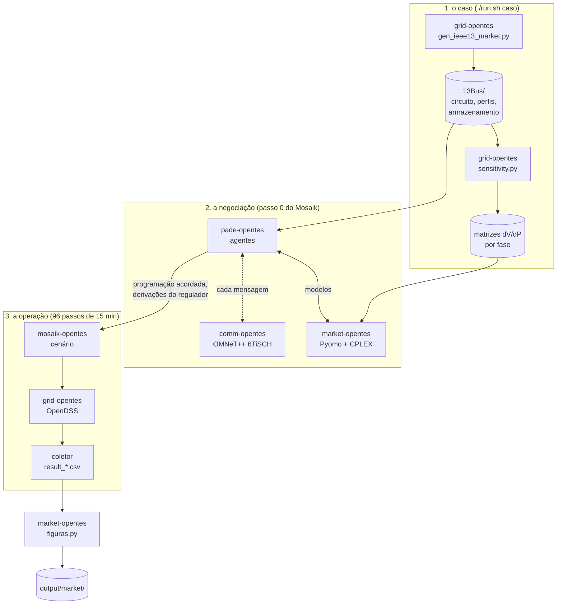

# OpenTES: mercado transativo por fase sobre a IEEE 13 barras

Co-simulação de um mercado transativo num alimentador de distribuição
desequilibrado. Prosumidores com baterias negociam a programação do dia seguinte
com o operador da rede (DSO), e um **preço sombra por fase** coordena os dois
lados para que a tensão de cada fase fique entre 0,97 e 1,03 pu. Agentes,
otimização, rede elétrica e rede de comunicação rodam cada um no seu simulador,
sincronizados pelo Mosaik.

## Como as peças se encaixam



1. **O caso.** O `grid-opentes` monta o caso de mercado a partir do circuito
   oficial da IEEE 13 e mede, no próprio OpenDSS, quanto a tensão de cada fase
   muda com 1 kW injetado em cada ponto: são as matrizes que o DSO usa para
   prever o efeito do armazenamento.
2. **A negociação.** No primeiro passo do Mosaik, os agentes do `pade-opentes`
   negociam: os prosumidores propõem a programação das baterias, o DSO confere
   as restrições de tensão, e o agente de mercado ajusta o preço sombra até os
   dois lados concordarem. Cada agente resolve o seu modelo de otimização com a
   biblioteca `market-opentes`. Com `NET_BACKEND=omnet`, cada mensagem passa
   pelo modelo de rede 6TiSCH do `comm-opentes`, que diz quanto ela demora e se
   ela se perde.
3. **A operação.** Nos 96 passos seguintes, o `mosaik-opentes` aplica a
   programação acordada no OpenDSS, com a demanda realizada (diferente da
   prevista), e grava a tensão de cada fase. É aqui que se confere, no fluxo de
   potência completo, o que a negociação prometeu com o modelo linear.

## Onde encontrar cada coisa

| Para entender... | Comece por | E leia |
|---|---|---|
| o que é medido e o que deu | [docs/paginas/resultados.md](docs/paginas/resultados.md) | `output/market/` depois de rodar |
| como a IEEE 13 vira um caso de mercado | [docs/paginas/caso.md](docs/paginas/caso.md) | `simulators/grid-opentes/src/simulators/gen_ieee13_market.py` |
| a formulação: os três modelos e o preço sombra | [docs/paginas/mercado.md](docs/paginas/mercado.md) | `simulators/market-opentes/market_opentes/optimization.py`, `dual.py` |
| por que a análise é por fase | [docs/paginas/mercado.md](docs/paginas/mercado.md), "A análise por fase" | `config.py` (as chaves por porta) e `sensitivity.py` (a matriz por fase) |
| quem manda mensagem para quem, e em que ordem | [simulators/pade-opentes/README.md](simulators/pade-opentes/README.md) | `simulators/pade-opentes/agents/market_agents.py` |
| a rede de comunicação | [simulators/comm-opentes/README.md](simulators/comm-opentes/README.md) | `Tisch.cc` e `agents/network_link.py` |
| como os simuladores são ligados | [docs/paginas/arquitetura.md](docs/paginas/arquitetura.md) | `simulators/mosaik-opentes/scenarios/market.py` |
| como rodar e o que cada variável muda | [docs/paginas/instalacao.md](docs/paginas/instalacao.md) | `run.sh` e `docker-compose.yaml` |

Cada pasta de `simulators/` tem um README próprio com o papel dela no projeto,
o que há dentro e como rodá-la sozinha.

## Rodar

Requisitos: Docker, Docker Compose e o IBM CPLEX (licença acadêmica, montado do
host em tempo de execução).

```bash
docker compose build
./run.sh
```

Sem argumentos, o `run.sh` abre um console com o logo, o estado do ambiente
(Docker, imagens, CPLEX, caso) e um menu: executar, refazer o último comando,
mudar a configuração, ver resultados, log e figuras, reconstruir as imagens e
reiniciar o ambiente. A configuração escolhida fica em `.opentes.env`, e cada
uma grava numa pasta própria de `output/`, para uma execução não apagar a outra.

Os mesmos comandos funcionam direto, para scripts:

```bash
export CPLEX_HOME=$HOME/IBM/CPLEX_Studio2211/cplex
./run.sh centralizado     # a negociação sem agentes, mais a liquidação (~1 min)
./run.sh market           # a co-simulação completa (~1 min; 15 a 20 min com a 6TiSCH)
./run.sh figuras          # as figuras, em output/market/figuras/
```

`./run.sh --help` lista os comandos e as variáveis. As principais:
`MARKET_FASE=0` analisa por barra, para comparação;
`MARKET_DISPOSITIVO=equilibrado` troca o inversor de quatro fios pelo de três;
`NET_BACKEND=omnet NET_TIME_SCALE=0.02` põe a rede 6TiSCH entre os agentes.

## Estrutura

```
run.sh                  ponto de entrada: market, centralizado, figuras, caso
cli/                    o console interativo que o ./run.sh abre, e o logo
docker-compose.yaml     os cinco contêineres e todas as variáveis, comentadas
simulators/
  grid-opentes/         rede elétrica: OpenDSS, o caso IEEE 13 e as matrizes de sensibilidade
  market-opentes/       modelo de mercado: otimização, decomposição dual, liquidação, figuras
  pade-opentes/         agentes do mercado, sobre o framework PADE (incluído)
  mosaik-opentes/       orquestração: o cenário e o coletor de resultados
  comm-opentes/         rede de comunicação 6TiSCH no OMNeT++
docs/                   documentação (MkDocs): páginas em docs/paginas/, site em docs/site/
output/                 resultados das execuções (fora do git)
pyproject.toml          ambiente Python local (uv), para IDE e scripts fora dos contêineres
```

## Documentação

As páginas em [docs/paginas/](docs/paginas/) podem ser lidas direto no GitHub,
ou como site:

```bash
uvx --with mkdocs-material mkdocs serve -f docs/mkdocs.yml    # http://127.0.0.1:8000
```

## Origem e autoria

O mecanismo de mercado vem da tese de doutorado de Lucas Silveira Melo (UFC,
2022, cap. 6), que o formulou e o aplicou a uma rede equilibrada, com uma
tensão e um preço por barra. Este trabalho o estende à IEEE 13, desequilibrada:
o operador vigia a tensão de cada fase, e o preço sombra é calculado por fase.
As referências completas estão em [docs/paginas/mercado.md](docs/paginas/mercado.md).

Time TTESO do projeto OpenTES, [GREI](https://github.com/grei-ufc), Universidade
Federal do Ceará, sobre componentes das equipes TSCC (comunicação) e TSRE (rede
elétrica). O framework PADE é do GREI ([grei-ufc/pade](https://github.com/grei-ufc/pade)).
Licença em [`LICENSE`](LICENSE).
