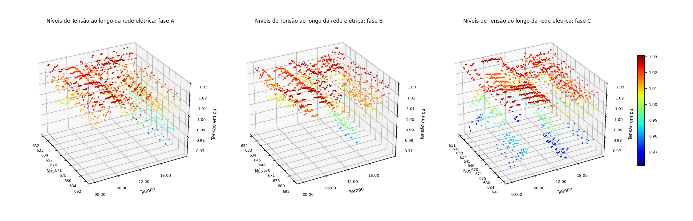
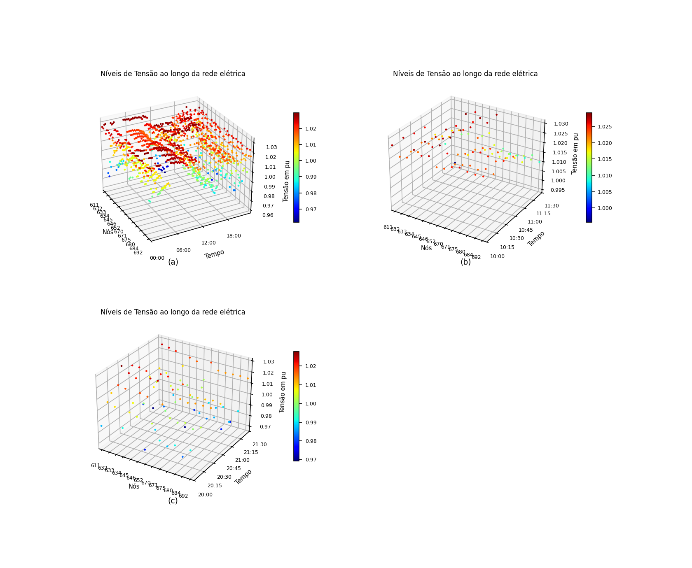
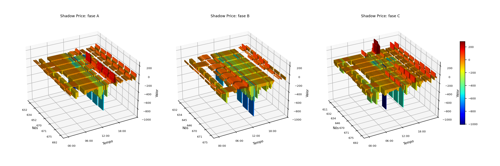

# Resultados

Todos os números desta página são do caso IEEE 13 como o repositório o gera, com
o regulador nas derivações da previsão, a rede ideal entre os agentes e um
cenário por prosumidor. Para refazê-los:

```bash
./run.sh centralizado && ./run.sh market && ./run.sh figuras                       # por fase
MARKET_FASE=0 ./run.sh centralizado && MARKET_FASE=0 ./run.sh market && MARKET_FASE=0 ./run.sh figuras   # por barra
```

As contagens são de leituras barra-fase-intervalo nas 32 fases de carga e de
passagem do alimentador (a subestação fica de fora), ao longo dos 96 intervalos
do dia. A faixa do mercado é 0,97 a 1,03 pu; a ANSI C84.1 Range A, 0,95 a
1,05 pu, conta também as fases da subestação.

## A co-simulação

A passada **base** executa a programação que os prosumidores propõem, sem
negociação. A **negociada** executa a programação acordada e, a cada 15 min, a
fase de operação sobre a demanda realizada. Em ambas, quem resolve a rede é o
OpenDSS, e não o modelo linear.

| Formulação | Passada | > 1,03 pu | < 0,97 pu | fora da ANSI A | rodadas |
|---|---|---:|---:|---:|---:|
| por barra (`MARKET_FASE=0`) | base | 472 | 65 | 95 | |
| | negociada | **134** | 18 | 3 | 48 |
| por fase (padrão) | base | 522 | 96 | 105 | |
| | negociada | **9** | 28 | **0** | 42 |

A formulação por barra cumpre o que promete: na **média** das fases, a negociada
tem zero leituras acima de 1,03 pu. Só que a média esconde 134 leituras de fase
acima do limite, concentradas na fase B (646, 645, 634, 675, 671) e na fase A da
634, ao longo do dia todo. Por fase, o excesso cai para 9 leituras, nenhuma
acima de 1,031 pu, e nenhuma leitura sai da ANSI A.

A subtensão residual cresce de 18 para 28 leituras, quase todas na fase C do
fim do ramal 684-611 (611, 684), à noite e no começo da manhã. A menor tensão é
0,961 pu, dentro da ANSI A. É o lado que a formulação por fase passa a ver e que
a por barra, vigiando a média, deixava de fora.

As linhas de base das duas formulações não são iguais porque a proposta do
prosumidor é aplicada de outro jeito: por barra, como carga equilibrada na
barra; por fase, dividida igualmente entre as portas.

=== "Por fase"

    

    Tensão de cada fase de cada barra ao longo do dia, na fase de operação da
    formulação por fase.

=== "Por barra"

    

    O mesmo gráfico na formulação por barra, que mostra a média das fases: (a) o
    dia, (b) e (c) as janelas de maior sobretensão e de maior subtensão. Nada
    passa de 1,03 pu, mas as fases individuais passam.

## O preço sombra por fase

Com a análise por fase, o λ deixa de ser uma superfície barra × tempo e passa a
ser três, uma por fase, cada uma só com as barras que têm aquela fase.



Os vales mais fundos, de −700 a −1.000, aparecem ao meio-dia, nas barras onde o
fotovoltaico mais excede a carga: é onde o DSO precisa que o armazenamento
absorva. O λ está na unidade de `Ck` vezes potência, e não em moeda (ver
[O modelo de mercado](mercado.md)).

## A negociação centralizada

A mesma decomposição dual sem agentes nem Mosaik, sobre a previsão. O fluxo não
linear é conferido com as derivações do regulador fixadas pela previsão:

| Formulação | > 1,03 pu | < 0,97 pu | fora da ANSI A | rodadas | energia deslocada |
|---|---:|---:|---:|---:|---:|
| por barra | 151 | 18 | 1 | 48 | 6.903 kWh |
| por fase, inversor de quatro fios | 9 | 28 | 0 | 42 | 7.527 kWh |
| por fase, inversor de três fios | 5 | 26 | 0 | 63 | 8.987 kWh |

Corrigir por fase custa 9% mais energia deslocada que corrigir a média, e
converge em menos rodadas. Com o inversor de três fios
(`MARKET_DISPOSITIVO=equilibrado`), o excesso cai um pouco mais, mas exige 19% mais energia que
o de quatro fios para o mesmo efeito, porque uma injeção igual nas três fases
mexe também nas fases que já estavam dentro da faixa. Na co-simulação, o de três
fios fica em 11 leituras acima e 26 abaixo, sem sair da ANSI A, e leva 63
rodadas contra 42.

As rodadas são as do critério de parada relativo (`MARKET_EPS_REL = 1e-3`, ver
[O modelo de mercado](mercado.md)). Com o critério absoluto da tese, eram 81, 66
e 108, para as mesmas contagens de tensão.

## Sobre a rede 6TiSCH

Com `NET_BACKEND=omnet NET_TIME_SCALE=0.02`, as mensagens atravessam a rede
6TiSCH do OMNeT++. O resultado elétrico é o mesmo da rede ideal: 42 rodadas, 9
leituras acima de 1,03 pu, 28 abaixo de 0,97 e nenhuma fora da ANSI A. Nenhuma
das 2.978 mensagens se perdeu, e não houve retransmissão. O despacho da
programação acordada, por FIPA-Subscribe, faz parte do tráfego: o DSO publica ao
concentrador, que publica aos 10 prosumidores, e as confirmações sobem.

O custo aparece no tempo. As mensagens do DSO, do concentrador e do agente de
mercado com λ e programação por porta têm de 20 a 34 kB, e o ciclo 3 de cada
rodada gastou de 474 a 541 s de rede, acima do orçamento de 300 s em **todas** as
42 rodadas. Somadas, são 5,8 h de rede para fechar a negociação do dia seguinte;
com o critério de parada absoluto, que pedia 66 rodadas, eram 9,1 h.
Na fase de operação, com uma rodada por janela, o ciclo fica em 22 s.

## Onde ficam os arquivos

Cada execução grava em `output/market/` (por fase) ou `output/market_por_no/`
(por barra). A lista do que cada arquivo contém está em
[Instalação e execução](instalacao.md#o-que-fica-gravado), e as figuras em
`figuras/`, dentro da mesma pasta.
