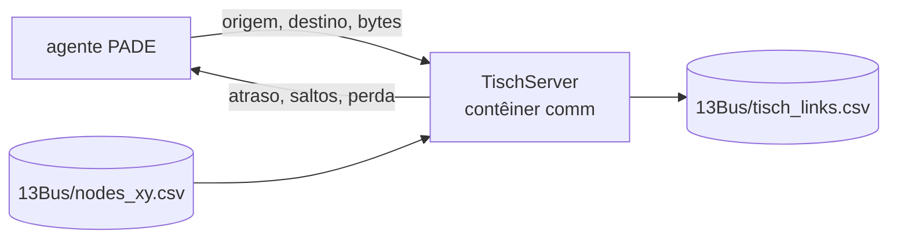

# comm-opentes: a rede de comunicação

O OMNeT++ com uma rede LPWA 6TiSCH entre os agentes: IEEE 802.15.4g a 50 kbps,
TSCH com salto de canal, perda de quadro pelo modelo de Pister-Hack e roteamento
multi-salto. O modelo de rede é o de Melo (2022, seção 6.1.5).

## O papel no projeto

Só entra na co-simulação com `NET_BACKEND=omnet`. Ela não participa do passo do
Mosaik: a negociação acontece inteira dentro de um passo de 15 minutos, com o
relógio da co-simulação parado. Por isso o OMNeT++ roda como **servidor de
rotas**. A cada mensagem que um agente envia, a camada de rede dos agentes
(`pade-opentes/agents/network_link.py`) pergunta por ZMQ, na porta 5556, qual o
caminho, o atraso e se a mensagem se perdeu, e agenda a entrega de acordo.



As posições dos agentes vêm do caso (`grid-opentes/src/data/13Bus/nodes_xy.csv`,
gerado com o comprimento real de cada linha). Como a IEEE 13 não tem topologia de
rádio publicada, os enlaces são os pares com PER abaixo de 0,5, e o servidor
grava em `tisch_links.csv` a rede que de fato simulou.

## O que há aqui

```
Tisch.cc        o servidor: modelo de rádio, enlaces, rotas e atraso salto a salto
Tisch.ned       os parâmetros do modelo, com o motivo de cada valor
omnetpp.ini     a configuração usada pelo projeto (seed, escala de tempo, arquivos)
Dockerfile      OMNeT++ 6 com ZMQ e JSON
```

## Rodar

Dentro do projeto:

```bash
NET_BACKEND=omnet NET_TIME_SCALE=0.02 ./run.sh market
```

`NET_TIME_SCALE` comprime o atraso nominal antes de aplicá-lo no relógio real:
com 1,0, cada rodada da negociação levaria minutos. Isolado, o contêiner compila
o modelo e sobe o servidor, que fica esperando consultas:

```bash
docker compose up comm      # a primeira vez compila e leva alguns minutos
```

O servidor anuncia `[6TiSCH] pronto` no log quando aceita consultas, com o MAC em
uso.

## Dois MACs sobre o mesmo rádio

| `TISCH_MAC` | O que é | Parâmetro principal |
|---|---|---|
| `tsch` (padrão) | 6TiSCH, a rede da tese: cada enlace transmite um quadro de 127 bytes em cada fatia reservada do *slotframe* de 4,04 s | `TISCH_CELLS`, fatias por enlace (padrão 2, calibrado com os tempos da tese) |
| `wisun` | Wi-SUN FAN: mesmo rádio IEEE 802.15.4g, mesma propagação e mesma regra de enlace, mas acesso por CSMA/CA com salto de canal assíncrono, sem fatia reservada, e quadros de 1.280 bytes | `TISCH_RATE_BPS`: 50 kbps (o rádio da tese), 150 ou 300 kbps |

No Wi-SUN, a sensibilidade piora 10·log₁₀(R / 50 kbps) dB com a taxa, então
taxas maiores têm menos enlaces e mais saltos; a topologia de cada taxa vai para
`tisch_links_wisun_<taxa>k.csv`, sem sobrescrever a da 6TiSCH. O erro de quadro
cresce com o tamanho, PER(L) = 1 − (1 − PER₁₂₇)^(L/127). Os parâmetros do MAC
(recuo do CSMA/CA, reversão, ACK) são os padrões do IEEE 802.15.4 e estão no
`Tisch.ned`. Nenhum dos dois modelos tem disputa entre enlaces: cada mensagem é
calculada sozinha, o que é otimista nos dois.

Os parâmetros do `Tisch.ned` podem ser trocados sem editar o arquivo, pela
variável `TISCH_ARGS`, que vai para a linha de comando do OMNeT++. Por exemplo,
para ligar por cabo os agentes que dividem a mesma coordenada (na IEEE 13, o
DSO, o agente de mercado e o concentrador):

```bash
TISCH_ARGS='--**.tisch.colocated_wired=true' NET_BACKEND=omnet NET_TIME_SCALE=0.02 ./run.sh market
```
