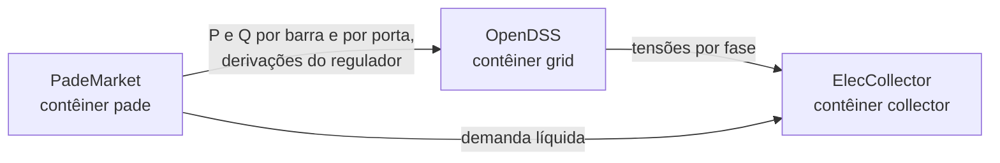

# mosaik-opentes: o orquestrador

O Mosaik sincroniza os simuladores num mesmo relógio, em passos de 15 minutos,
e liga as saídas de um às entradas do outro.

## O papel no projeto

O cenário conecta três simuladores:



No primeiro passo, os agentes negociam a programação do dia: o passo do Mosaik
fica aberto até a negociação fechar. Nos 96 passos seguintes, a programação
acordada é aplicada no OpenDSS e as tensões são registradas pelo fluxo de
potência completo. É assim que se confere, na solução não linear, a promessa que
a negociação fez com o modelo linearizado.

## O que há aqui

```
scenarios/market.py           o cenário: cria as entidades e liga os simuladores
collectors/elec_collector.py  grava tensões e potências de cada passo em result_<tag>.csv
Dockerfile                    a imagem opentes/mosaik (Mosaik, pandas, matplotlib)
```

O cenário cria uma entidade para cada barra com prosumidor, cada porta de
armazenamento por fase e cada regulador de tensão, e liga as tensões de todas as
barras ao coletor. As cargas do circuito que não seguem a convenção do mercado
(as oficiais, desabilitadas) são listadas e ignoradas.

## Rodar

Pelo `run.sh` da raiz, que sobe os contêineres na ordem certa e espera cada um
ficar pronto antes do próximo: `./run.sh market`. A ordem importa porque os
simuladores remotos aceitam uma única conexão. A mesma imagem roda o coletor
(contêiner `collector`) e as figuras do mercado (`./run.sh figuras`).
